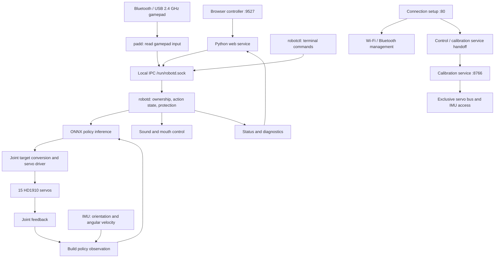

# EasyDuck

**An open-source biped robot powered by TaishanPi 1M, with on-board motion policies that bring a walking duck to life.**

**English** | [简体中文](README.zh-CN.md) · [Hardware and build tutorials](https://oshwlab.com/lckfb-team/project_eouzeufa) · [Software docs](docs/en/README.md) · [Policy training](https://github.com/LuwuDynamics/xgoduck_rl)

EasyDuck combines TaishanPi 1M (RK3566), 15 HD1910 servos, and an IMU for browser/gamepad control, walking, standing, sit/stand, fall recovery, pickup, and head movement.

Motion policies run locally on the board. The daemon feeds operator commands, body orientation, joint feedback, and the previous action into an ONNX model, converts its output into servo targets, and adjusts motion using fresh feedback.

## Demonstrations

<table>
  <tr>
    <td colspan="2" align="center" valign="middle" width="33%" height="220">
      
    </td>
    <td colspan="2" align="center" valign="middle" width="33%" height="220">
      
    </td>
    <td colspan="2" align="center" valign="middle" width="33%" height="220">
      
    </td>
  </tr>
  <tr>
    <td colspan="2" align="center"><strong>Sit and stand</strong></td>
    <td colspan="2" align="center"><strong>Head control</strong></td>
    <td colspan="2" align="center"><strong>Pickup</strong></td>
  </tr>
  <tr>
    <td colspan="3" align="center" valign="middle" width="50%" height="220">
      
    </td>
    <td colspan="3" align="center" valign="middle" width="50%" height="220">
      
    </td>
  </tr>
  <tr>
    <td colspan="3" align="center"><strong>Walking</strong></td>
    <td colspan="3" align="center"><strong>Standing and balance</strong></td>
  </tr>
</table>

## Open-source projects and resources

Hardware, software, and tutorials are open source. Use these entry points for each part of the project.

| Resource | Contents |
| --- | --- |
| [Hardware](https://oshwlab.com/lckfb-team/project_eouzeufa) | Hardware design files |
| [Software](https://github.com/jlckfb/easyduck) | This repository: on-board control, browser UI, calibration tools, deployment scripts, and motion policies |
| [Build tutorials](https://oshwlab.com/lckfb-team/project_eouzeufa) | Hardware and tutorials share one project page, covering the build and operation |
| [XGO Duck training](https://github.com/LuwuDynamics/xgoduck_rl) | Upstream simulation and reinforcement-learning project with training environments, policy playback, and ONNX export |
| [Software guide](docs/en/software-guide.md) | EasyDuck installation, calibration, daily operation, and rollback |

Training runs on a GPU-equipped computer; EasyDuck runs the exported ONNX policies on TaishanPi. XGO Duck training is based on [Pollen Robotics/microduck_rl](https://github.com/pollen-robotics/microduck_rl). Model origins, pinned revisions, and interfaces are recorded in the [model guide](docs/en/models.md) and [manifest](models/manifest.json).

## Features

| Feature | Description |
| --- | --- |
| Motion control | Walking, zero-speed standing, fall recovery, commanded sit/stand, and pickup, subject to the loaded policies and current state |
| Browser control | Twin sticks, head movement, speed adjustment, vocalization, and status; the remote page supports Chinese/English switching |
| Gamepad control | PS5 DualSense over Bluetooth and tested Xbox 360 protocol USB/2.4 GHz receivers, with browser/gamepad ownership handoff |
| Calibration workbench | Servo IDs, hardware center, HOME, direction, travel limits, 3D feedback, and robot-specific calibration import/export |
| IMU support | BNO085 and LSM6DSV16X, with installation rotation and static bias stored per model |
| Connectivity and services | Wi-Fi setup, PS5 pairing/reconnection, service startup, and restart after process exit |
| Low-battery protection | The board profile preempts normal control at a valid smoothed bus voltage ≤6.2 V, sits when possible, then releases torque and locks normal control |

Motion availability depends on policies, calibration, power, and feedback. Low-battery protection leaves Linux running. The browser has no jump or roulade button; retained kick/body bindings do not imply that the current control flow executes those actions.

## Getting started

### Hardware

| Component | Supported configuration |
| --- | --- |
| Controller | TaishanPi 1M, RK3566, ARM64 Linux with systemd |
| Servos | 15 HD1910 servos on UART3 by default, with matching half-duplex direction control |
| IMU | BNO085 or LSM6DSV16X; default I²C bus `/dev/i2c-2` |
| Input | Browser, PS5 DualSense, or a tested USB/2.4 GHz receiver gamepad |

The system needs Python 3.11+, ONNX Runtime, ALSA, NetworkManager, BlueZ, and matching board drivers. USB receivers require the kernel's `xpad` driver. See [deployment](docs/en/deployment.md) and [USB gamepad support](docs/en/usb-gamepad.md) for dependencies and installation.

### First motion

1. Follow the [build tutorials](https://oshwlab.com/lckfb-team/project_eouzeufa) to prepare the hardware, system, and wiring.
2. Open connection setup at the board's address to configure Wi-Fi or pair a gamepad. See [network access](docs/en/network-access.md) for finding the address.
3. Support the robot and enter calibration. Set servo IDs, hardware center, HOME, direction, travel limits, and IMU calibration, then export a backup.
4. Check policies and robot-specific parameters using the [configuration guide](docs/en/configuration.md). Repository templates disable policies by default; enable model loading after calibration.
5. Open the remote page, choose **Take web control** (「用网页控制」), check **Default stance** (「默认站姿」), then enable walking. For gamepad use, return ownership, release sticks/buttons, and press Start/Options.

| Page | Default address |
| --- | --- |
| Connection setup | `http://BOARD_IP/` |
| Browser remote | `http://BOARD_IP:9527/` |
| Calibration workbench | `http://BOARD_IP:8766/`, after the page/service handoff |

Replace `BOARD_IP` with the board's current address. Support the robot before using **Release torque** (「断力」). Full button mappings, calibration steps, and configuration instructions are in the [software guide](docs/en/software-guide.md).

### Build the applications

On a Linux x86-64 build host with Docker Engine, Bash, GNU tar, `sha256sum`, and `file`, run these commands from this repository's root:

```sh
docker build -f deploy/Dockerfile -t easyduck-build:1.98.1 .
docker run -d --name easyduck-build --network none easyduck-build:1.98.1
bash deploy/build.sh
(cd models && sha256sum -c SHA256SUMS)
```

Creating the build environment requires network access. ARM64 binaries are written to `build/bin/`. If the named container already exists, follow [build and deployment](docs/en/deployment.md). The board SDK builds complete system images; this repository's installer handles application files and service integration.

## Architecture

EasyDuck centers on `robotd`: the browser and gamepad receive operator input, the daemon runs policies using servo and IMU feedback, and the driver converts policy results into servo targets. Connection setup, hardware calibration, and service management support this control chain.

### Components and responsibilities



| Component | Responsibility | Source |
| --- | --- | --- |
| Connection setup | Configure Wi-Fi, pair Bluetooth gamepads, coordinate page and control-service handoff | `deploy/setup/` |
| Web control service | Receive browser joystick/button input, submit requests, return robot status | `web/` |
| `padd` | Read gamepad input and convert buttons/axes into shared control requests | `runtime/padd/` |
| `robotctl` | Terminal control, status inspection, and diagnostics | `runtime/robotctl/` |
| `robotd` | Manage ownership and action state, run policies, coordinate hardware I/O and protection | `runtime/robotd/` |
| Hardware/inference library | Implement servo communication, IMU processing, policy observations/actions, and inference | `runtime/duck-control/` |
| Calibration service | Assign servo IDs; set hardware center, HOME, direction, limits, and IMU calibration | `calibration/` |
| Sound generation and playback | `sounds` builds the sound bank; daemon-side logic handles runtime playback and mouth coordination | `runtime/sounds/`, `runtime/robotd/` |

`duck-ipc-proto` defines inter-process messages, `robotd-params` parses configuration, and `kinematics` provides pose geometry. These shared crates compile into the programs and do not run as separate services. See [runtime](docs/en/runtime.md).

### From operator input to motion

When an operator pushes the gamepad forward, `padd` converts the stick position into a forward-motion request and sends it to `robotd` through a local Unix socket. Browser input reaches the same daemon interface. The daemon evaluates ownership, action state, and protection conditions before deciding how to execute the request.

The current XGO control path targets **50 Hz, approximately one update every 20 ms**. Each update combines joint feedback, IMU data, and accepted commands, builds a policy observation, runs inference, and converts the result into servo targets. Subsequent updates use feedback from execution to keep adjusting motion. Linux scheduling and hardware communication affect actual timing; this is not a hard real-time deadline guarantee.

| Policy input | Width | Purpose |
| --- | ---: | --- |
| Body angular velocity | 3 | Describe how the body is rotating |
| Gravity projected into the body frame | 3 | Describe body tilt |
| Joint positions | 14 | Express positions relative to the policy reference pose |
| Joint velocities | 14 | Describe joint motion |
| Previous policy output | 14 | Provide the preceding action to the current inference |
| Movement, head, and body commands | 13 | Represent operator intent; fields unused by the current control path remain zero |

This gives **61 observation values and 14 action values**. The servo driver uses robot-specific calibration to convert model joint targets into physical servo targets; mouth ID34 is controlled separately. Observation order, units, joint directions, and action scaling must match the policy. See [model interfaces and provenance](docs/en/models.md).

### Browser/gamepad ownership and hardware access

During normal operation, `robotd` owns the servo bus and IMU. The browser service, `padd`, and `robotctl` submit requests through local IPC; the daemon manages ownership between browser and gamepad.

Automatic selection prefers an online gamepad. Explicit browser takeover keeps browser ownership. Returning to the gamepad requires released sticks, triggers, and buttons, followed by a neutral-input check after handoff. **Ownership and walking enablement are separate states**: changing input source does not itself request walking.

Gamepad support has two layers: BlueZ and the relevant input drivers support Bluetooth pads, while `xpad` supports the tested USB receiver. They expose Linux input devices that `padd` reads and converts. Browser and gamepad commands ultimately share the same daemon execution path.

### Calibration and configuration handoff

Calibration needs direct servo and IMU access, so it runs separately from normal control. Authenticated page navigation coordinates the handoff, and systemd unit conflicts prevent the calibration service and `robotd` from running concurrently.

The usual sequence is: **support the robot → stop normal control and request torque release → let calibration take ownership → save robot-specific parameters → leave calibration → reopen normal control with saved configuration**. A successful service switch does not prove that every servo released torque when power or communication is faulty.

`robotd.toml` holds hardware, policy, and other runtime settings; `visual_calibration.json` holds robot-specific servo and IMU calibration. Calibration maps physical installation, direction, and travel into shared software coordinates. Unsaved browser drafts are not persistent, and saving does not live-reconfigure an already running daemon. Leaving calibration restarts normal-control services so they reopen hardware and read saved data. See [configuration precedence](docs/en/configuration.md).

### Startup and runtime protection

Linux `systemd` manages services, starts programs, restarts them after exits according to their unit settings, and retains logs. It manages process lifetime; `robotd` handles control state, input timeouts, feedback/sensor checks, low-battery behavior, and related runtime logic. Process restart does not cover every hang or hardware failure.

**A running process, a controller ready for input, and a robot executing motion are different states.** Templates disable motion policies by default, and service startup does not mean automatic torque or walking. Low-battery sitting also depends on hardware and action state; protection must handle cases where sitting cannot execute, so a protection request is not proof of completed motion.

### System and extension boundaries

The SDK/system image supplies board Linux, UART half-duplex support, USB input drivers, and system components. This repository supplies applications, models, configuration, and application deployment. Installing application files does not install a matching kernel driver.

New input clients can reuse daemon interfaces. A replacement IMU needs a driver adapter with consistent units, coordinates, installation calibration, and freshness handling. A replacement policy must preserve the observation/action contract. Training and on-board inference are maintained separately; this repository does not contain a complete training environment.

The setup page requires login, but the control page (`:9527`) and calibration workbench (`:8766`) do not authenticate their own API requests. They listen on all interfaces by default. Same-origin checks and control ownership are not account authentication; use these services only on a trusted network and do not expose their ports to the Internet.


## Documentation

| Goal | Read |
| --- | --- |
| Install, configure, and operate | [Software guide](docs/en/software-guide.md) |
| Build, install, or roll back applications | [Deployment](docs/en/deployment.md) |
| Configure networking and gamepad pairing/reconnection | [Connection setup](docs/en/connection-setup.md) · [USB/2.4 GHz gamepads](docs/en/usb-gamepad.md) |
| Calibrate servos and orientation sensors | [Calibration](docs/en/calibration.md) · [IMU integration](docs/en/imu-drivers.md) |
| Understand policy interfaces and provenance | [Motion policies](docs/en/models.md) |
| Understand battery handling | [Low-battery protection](docs/en/low-battery.md) |
| Browse every guide and module introduction | [English documentation index](docs/en/README.md) |

## Repository layout

| Directory | Responsibility |
| --- | --- |
| [runtime/](runtime/README.md) | Rust daemon, gamepad client, CLI, sound generator, and shared libraries |
| [web/](web/README.md) | Browser remote and Python gateway |
| [calibration/](calibration/README.md) | Servo/IMU calibration and 3D workbench |
| [config/](config/README.md) | Public configuration templates and board parameters |
| [models/](models/README.md) | ONNX models, provenance, and hashes |
| [deploy/](deploy/README.md) | Build, installation, rollback, services, and driver integration |
| [docs/](docs/README.md) | Paired English and Chinese guides |
| [assets/](assets/README.md) | Hardware photos and demonstration GIFs |
| [examples/](examples/README.md) · [tools/](tools/README.md) | Development examples and repository checks |

## Contributing

Issues and improvements are welcome. Include hardware, model configuration, reproduction steps, and logs in reports. Run the relevant checks before submitting code. Arrange physical support and access to power isolation for motion tests.

See the [repository maintenance rules](AGENTS.md). Keep documentation changes paired across English and Chinese. Record provenance and licenses for new code/assets; keep private calibration, credentials, and build outputs outside the repository.

## Acknowledgments and license

EasyDuck's Rust foundation comes from Pollen Robotics' Microduck. Parts of its motion flow, web UI, and models come from XGO Duck; training references XGO Duck RL and Microduck RL. Thanks to those projects and their contributors.

The root project license is [Apache-2.0](LICENSE). Third-party content retains its own terms, including GPL-3.0-or-later, GPL-2.0-only, and MIT. Redistribution terms for four motion models and some derived content remain unresolved in the recorded upstream revisions and require file-level review.

See [NOTICE](NOTICE), [third-party notices](THIRD_PARTY_NOTICES.md), the [model manifest](models/manifest.json), and [license texts](LICENSES/README.md) for provenance, adaptations, and license scope.
