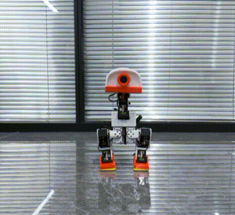
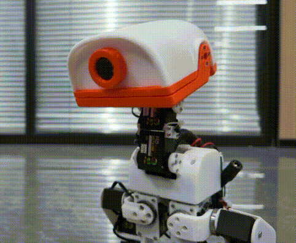
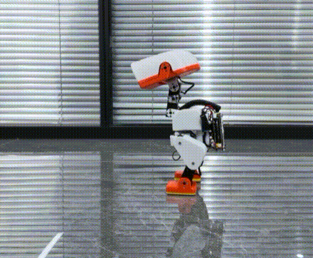
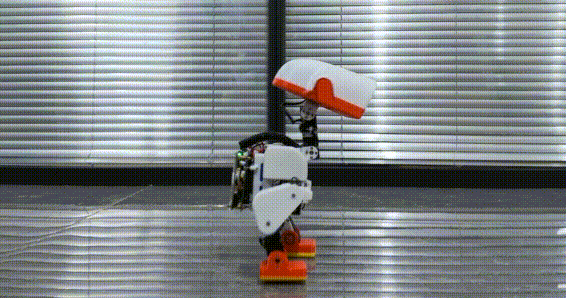
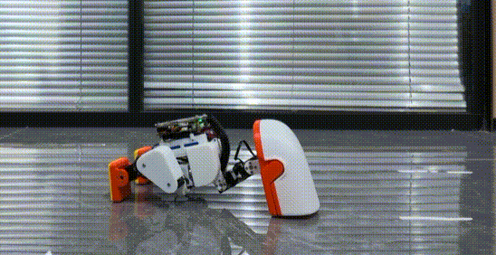
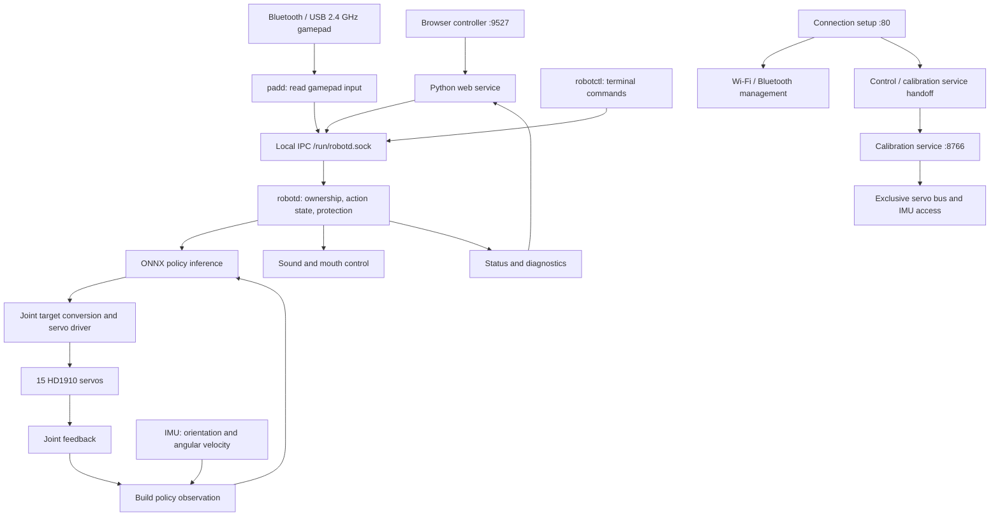

# EasyDuck

**On-board control software for a TaishanPi 1M (RK3566) biped robot.**

**English** | [简体中文](README.zh-CN.md)

[Documentation](docs/en/README.md) · [中文文档](docs/zh-CN/README.md)

EasyDuck adapts the Microduck software foundation and XGO Duck policy/control flow to a TaishanPi robot with 15 HD1910 servos and an I²C IMU. It provides the on-board path from hardware setup and calibration to gamepad/browser input, closed-loop policy inference, servo targets, and diagnostics.

The robot's gait is produced by ONNX policy inference on the board, using joint feedback, IMU data, previous actions, and operator commands. The web page is a control client and calibration workbench; it does not calculate a gait in the browser. The 3D view visualizes reference poses and measured joints/body orientation, not a physics simulation.

This repository contains **application source, deployment tools, and five ONNX models**. It does not include a complete board SDK, Linux distribution, flashable firmware release, mechanical design, or model-training workspace. The build commands below produce application binaries, not an operating-system image.

> **License scope:** this is a mixed-source repository. Some upstream models and derived runtime content have no explicit redistribution license in the recorded upstream revision. The root Apache-2.0 license does not cover every file. See [License and provenance](#license-and-provenance).

## Hardware and demonstrations

<table>
  <tr>
    <td colspan="2" align="center" valign="middle" width="33%" height="220">
      
    </td>
    <td colspan="2" align="center" valign="middle" width="33%" height="220">
      
    </td>
    <td colspan="2" align="center" valign="middle" width="33%" height="220">
      
    </td>
  </tr>
  <tr>
    <td colspan="2" align="center"><strong>Sit and stand</strong></td>
    <td colspan="2" align="center"><strong>Head control</strong></td>
    <td colspan="2" align="center"><strong>Pickup</strong></td>
  </tr>
  <tr>
    <td colspan="3" align="center" valign="middle" width="50%" height="220">
      
    </td>
    <td colspan="3" align="center" valign="middle" width="50%" height="220">
      
    </td>
  </tr>
  <tr>
    <td colspan="3" align="center"><strong>Walking</strong></td>
    <td colspan="3" align="center"><strong>Standing and balance</strong></td>
  </tr>
</table>


## Features

- **Motion:** walking, zero-speed standing, fall recovery, commanded sit/stand, and pickup. Roulade requests remain available through supported gamepad/CLI paths; the web controller exposes neither roulade nor jumping.
- **Web remote:** drive/head joysticks, neck-pitch and head-roll sliders, speed adjustment, status inspection, and press-and-hold vocalization with mouth movement.
- **Gamepads:** PS5 DualSense over Bluetooth and tested USB/2.4 GHz receivers presenting an Xbox 360 controller. Both use the existing drive, head, motion, mouth, and sound controls, with ownership handoff between gamepad and browser. Retained body-mode/kick bindings are not active capabilities of the shipped XGO control path.
- **Calibration:** servo ID assignment, independent hardware-center and HOME buttons, direction, travel limits, 3D feedback, whole-body reference pose, and JSON import/export.
- **Two IMUs:** BNO085 and LSM6DSV16X. The daemon and calibration service share hardware settings, with installation rotation and bias stored per model.
- **Connection setup:** NetworkManager Wi-Fi configuration, BlueZ pairing, and reconnection attempts for registered PS5 controllers.
- **Low-battery protection:** the board profile uses valid smoothed bus voltage at or below 6.2 V to preempt ordinary control, attempt sitting when possible, release torque, and latch ordinary controls until the daemon restarts. It does not shut down Linux or energize an already relaxed robot.
- **Deployment:** ARM64 builds, staged installation, hashes, preservation of existing configuration, installation backups, and file rollback.

Motion availability depends on installed models, configuration, feedback, and controller state. A successful build or service start is not physical-motion validation.

### Shipped control profile and model contract

The installed `40-xgoduck-reference.conf` sets `ROBOTD_CONTROL_PROFILE=xgoduck`. This selects a 50 Hz control path in `robotd/src/main.rs` and the action state machine in `xgo.rs`. The source also retains a generic controller; its optional features must not be assumed to work in the XGO path.

| Policy slot | Bundled purpose in the XGO profile |
| --- | --- |
| `walk`, `stand` | The same walking policy, also used for zero-speed standing |
| `sitstand` | Get-up policy for fall recovery |
| `posture` | Separate commanded sit/stand policy; also used by low-battery sitting |
| `ground_pick` | Pickup policy, driven with an encoded action phase |
| `roulade` | Roulade policy; gamepad/CLI requests, no web button |
| `kick_left`, `kick_right` | Not bundled; reference configuration sets both to `none`, and the XGO loop does not run kick requests |

Policies consume 61 values and produce 14 actions. The driver handles all 15 servos, with mouth ID34 controlled separately. Saved encoder HOME/direction/limits are converted to model joint coordinates by the SCS driver; a model's nominal angles are not encoder calibration. See [model interfaces and provenance](docs/en/models.md).

## Requirements

| Component | Supported configuration |
| --- | --- |
| Board | TaishanPi 1M, Rockchip RK3566, Linux ARM64 with systemd |
| Servos | 15 HD1910 servos, default serial device `/dev/ttyS3` |
| Serial support | UART3 half-duplex direction control matching the device tree; a serial device node alone is insufficient |
| IMU | **BNO085 or LSM6DSV16X only**, default bus `/dev/i2c-2` |
| Gamepad | PS5 DualSense through BlueZ, or tested USB/2.4 GHz receivers through Linux `xpad`; see [USB gamepad requirements](docs/en/usb-gamepad.md) |
| Audio | Working board audio configuration and ALSA `aplay` / `amixer` |
| Python | Python 3.11+ for all components, including calibration |
| Native dependencies | libudev and ONNX Runtime 1.23+ providing `libonnxruntime.so` |
| Connection setup | NetworkManager/`nmcli`, BlueZ/`bluetoothctl`, system `libcrypt` |
| Browser | JavaScript and WebGL for the 3D workbench; three.js is vendored |

GPIO polarity and wiring must come from the target device tree. The installer does not install the kernel, board drivers, or ONNX Runtime. See [IMU drivers](docs/en/imu-drivers.md) for supported configuration combinations.

Microphone sensing, ToF depth sensing, and odometry are not implemented. Some `robotctl` network, pairing, and update clients depend on external services not included here.

## Architecture

EasyDuck centers on `robotd`: the browser and gamepad receive operator input, the daemon runs policies using servo and IMU feedback, and the driver converts policy results into servo targets. Connection setup, hardware calibration, and service management support this control chain.

### Components and responsibilities



| Component | Responsibility | Source |
| --- | --- | --- |
| Connection setup | Configure Wi-Fi, pair Bluetooth gamepads, coordinate page and control-service handoff | `deploy/setup/` |
| Web control service | Receive browser joystick/button input, submit requests, return robot status | `web/` |
| `padd` | Read gamepad input and convert buttons/axes into shared control requests | `runtime/padd/` |
| `robotctl` | Terminal control, status inspection, and diagnostics | `runtime/robotctl/` |
| `robotd` | Manage ownership and action state, run policies, coordinate hardware I/O and protection | `runtime/robotd/` |
| Hardware/inference library | Implement servo communication, IMU processing, policy observations/actions, and inference | `runtime/duck-control/` |
| Calibration service | Assign servo IDs; set hardware center, HOME, direction, limits, and IMU calibration | `calibration/` |
| Sound generation and playback | `sounds` builds the sound bank; daemon-side logic handles runtime playback and mouth coordination | `runtime/sounds/`, `runtime/robotd/` |

`duck-ipc-proto` defines inter-process messages, `robotd-params` parses configuration, and `kinematics` provides pose geometry. These shared crates compile into the programs and do not run as separate services. See [runtime](docs/en/runtime.md).

### From operator input to motion

When an operator pushes the gamepad forward, `padd` converts the stick position into a forward-motion request and sends it to `robotd` through a local Unix socket. Browser input reaches the same daemon interface. The daemon evaluates ownership, action state, and protection conditions before deciding how to execute the request.

The current XGO control path targets **50 Hz, approximately one update every 20 ms**. Each update combines joint feedback, IMU data, and accepted commands, builds a policy observation, runs inference, and converts the result into servo targets. Subsequent updates use feedback from execution to keep adjusting motion. Linux scheduling and hardware communication affect actual timing; this is not a hard real-time deadline guarantee.

| Policy input | Width | Purpose |
| --- | ---: | --- |
| Body angular velocity | 3 | Describe how the body is rotating |
| Gravity projected into the body frame | 3 | Describe body tilt |
| Joint positions | 14 | Express positions relative to the policy reference pose |
| Joint velocities | 14 | Describe joint motion |
| Previous policy output | 14 | Provide the preceding action to the current inference |
| Movement, head, and body commands | 13 | Represent operator intent; fields unused by the current control path remain zero |

This gives **61 observation values and 14 action values**. The servo driver uses robot-specific calibration to convert model joint targets into physical servo targets; mouth ID34 is controlled separately. Observation order, units, joint directions, and action scaling must match the policy. See [model interfaces and provenance](docs/en/models.md).

### Browser/gamepad ownership and hardware access

During normal operation, `robotd` owns the servo bus and IMU. The browser service, `padd`, and `robotctl` submit requests through local IPC; the daemon manages ownership between browser and gamepad.

Automatic selection prefers an online gamepad. Explicit browser takeover keeps browser ownership. Returning to the gamepad requires released sticks, triggers, and buttons, followed by a neutral-input check after handoff. **Ownership and walking enablement are separate states**: changing input source does not itself request walking.

Gamepad support has two layers: BlueZ and the relevant input drivers support Bluetooth pads, while `xpad` supports the tested USB receiver. They expose Linux input devices that `padd` reads and converts. Browser and gamepad commands ultimately share the same daemon execution path.

### Calibration and configuration handoff

Calibration needs direct servo and IMU access, so it runs separately from normal control. Authenticated page navigation coordinates the handoff, and systemd unit conflicts prevent the calibration service and `robotd` from running concurrently.

The usual sequence is: **support the robot → stop normal control and request torque release → let calibration take ownership → save robot-specific parameters → leave calibration → reopen normal control with saved configuration**. A successful service switch does not prove that every servo released torque when power or communication is faulty.

`robotd.toml` holds hardware, policy, and other runtime settings; `visual_calibration.json` holds robot-specific servo and IMU calibration. Calibration maps physical installation, direction, and travel into shared software coordinates. Unsaved browser drafts are not persistent, and saving does not live-reconfigure an already running daemon. Leaving calibration restarts normal-control services so they reopen hardware and read saved data. See [configuration precedence](docs/en/configuration.md).

### Startup and runtime protection

Linux `systemd` manages services, starts programs, restarts them after exits according to their unit settings, and retains logs. It manages process lifetime; `robotd` handles control state, input timeouts, feedback/sensor checks, low-battery behavior, and related runtime logic. Process restart does not cover every hang or hardware failure.

**A running process, a controller ready for input, and a robot executing motion are different states.** Templates disable motion policies by default, and service startup does not mean automatic torque or walking. Low-battery sitting also depends on hardware and action state; protection must handle cases where sitting cannot execute, so a protection request is not proof of completed motion.

### System and extension boundaries

The SDK/system image supplies board Linux, UART half-duplex support, USB input drivers, and system components. This repository supplies applications, models, configuration, and application deployment. Installing application files does not install a matching kernel driver.

New input clients can reuse daemon interfaces. A replacement IMU needs a driver adapter with consistent units, coordinates, installation calibration, and freshness handling. A replacement policy must preserve the observation/action contract. Training and on-board inference are maintained separately; this repository does not contain a complete training environment.

The setup page requires login, but the control page (`:9527`) and calibration workbench (`:8766`) do not authenticate their own API requests. They listen on all interfaces by default. Same-origin checks and control ownership are not account authentication; use these services only on a trusted network and do not expose their ports to the Internet.

## Build

Run from the cloned repository root on a **Linux x86-64 build host** with Bash, Docker Engine, GNU tar, `sha256sum`, and `file`:

```sh
docker build -f deploy/Dockerfile -t easyduck-build:1.98.1 .
docker run -d --name easyduck-build --network none easyduck-build:1.98.1
bash deploy/build.sh
(cd models && sha256sum -c SHA256SUMS)
```

Creating the build image requires network access. Application builds then use the Cargo lockfile and an offline dependency cache. The Dockerfile selects Rust 1.98.1 and the `aarch64-unknown-linux-gnu` target; the workspace declares Rust 1.89 as its minimum. This is not a native Windows build.

If the container already exists but is stopped, use `docker start easyduck-build`. Dependency changes may require rebuilding the image. Toolchain overrides are documented in [build and deployment](docs/en/deployment.md).

| Output | Contents |
| --- | --- |
| `build/bin/` | Four ARM64 executables |
| `build/logs/arm-build.log` | Build log |
| `build/binaries-SHA256SUMS` | Executable checksums |
| `build/binary-types.txt` | Binary architecture information |

Model checksums verify file integrity, not behavior. Complete firmware requires a separate SDK workflow for kernel, device tree, rootfs, service enablement, and packaging.

## Installation and configuration

### Stage files on the build host

After building:

```sh
python3 deploy/install.py --root build/stage --profile examples
```

This installs binaries, models, web resources, templates, service definitions, and license files into a dedicated staging directory. It does not access hardware or start services. Existing files in the staging directory may be updated.

`examples` provides format examples; `board` provides TaishanPi hardware reference parameters. **Both are uncalibrated templates with policies disabled.** Only `board` explicitly enables low-battery sit protection.

Here, `[policy] enabled = false` prevents the controller from loading motion policies; it is not merely the initial torque-off state. After completing calibration and checking model paths/dependencies, set `[policy] enabled = true` in the target's `/etc/robot/robotd.toml` to load policies on the next daemon start. Support the robot before restarting or changing service ownership. Loading policies still does not itself request walking or torque on.

### Install on the robot

Prepare target dependencies, transfer the installation source and ARM64 binaries to the board, support the robot, and stop conflicting services. Then run from the source directory **on the board**:

```sh
sudo python3 deploy/install.py --root / --profile board --install-on-board
```

The installer prints a backup directory with `manifest.json`. Existing `/etc/robot/` files are preserved by default. `--replace-config` replaces configuration and creates backups; do not use it casually on a calibrated robot.

Install the setup page and reconnect timer with an **existing system account**, replacing `your-user`:

```sh
sudo bash deploy/setup/install.sh --port 80 --user your-user
```

This starts the setup services, uses the existing account's system password, and preserves an existing `/etc/easyduck/setup.env`. It does not create an account, set passwords, configure SSH, or create USB networking. See [connection setup](docs/en/connection-setup.md).

Preview normal-control startup commands before executing them on the prepared target:

```sh
bash deploy/start.sh --preview
sudo bash deploy/start.sh --execute
```

This starts normal-control services, not calibration. It does not replace setup-page installation or prove that boot-time service enablement is complete. Dependency setup, verification, and rollback are covered in [deployment](docs/en/deployment.md) and the [software guide](docs/en/software-guide.md).

### Runtime files

| Board path | Purpose |
| --- | --- |
| `/etc/robot/robotd.toml` | Hardware, policy paths, safety, audio |
| `/etc/robot/visual_calibration.json` | Joint and per-model IMU calibration |
| `/etc/robot/zero_pos.json` | Calibration baseline and legacy fallback inputs |
| `/etc/robot/scs_joint_gains.json` | Joint gains |
| `/etc/easyduck/setup.env` | Setup account and ports |
| `/opt/robot/daemon/policies/` | Installed policies |

Keep robot-specific calibration, credentials, Wi-Fi profiles, Bluetooth pairings, and browser sessions out of distributable templates. File precedence is explained in [configuration](docs/en/configuration.md).

## Calibration

Support the robot before entering calibration: service handoff stops normal control and requests torque release. If servo power or communication is faulty, a successful page switch does not prove that every servo has released torque. Never manually force a powered joint.

Assign unique servo IDs for a new robot; existing IDs do not need to be assigned again. For each joint, set its initial hardware center and HOME, record safe travel limits, compare the model's positive direction with a physical step, and save. Hardware center and HOME are separate operations. Later HOME corrections do not require resetting the center, direction, or limits.

After saving all joints, return them to HOME, inspect the actual torso, and record the whole-body reference pose. The template counts `2048` and `0–4095` are placeholders, not measured calibration.

**Check IMU detects only BNO085 and LSM6DSV16X.** Capture upright and at least one of forward-down/left-down; backward-down and right-down are also available. Hold each pose still for at least two seconds. Compute the installation rotation, compare model tilt with the physical body, capture stationary bias, and save.

Export a JSON backup after both calibrations. Importing produces a draft: inspect it and save all drafts to persist it. Use a backup only for its original robot. See [calibration](docs/en/calibration.md) for the workbench and hardware-free `--mock` preview. UI labels are currently Chinese.

## Web and gamepad controls

Use the board's reachable address after installation; these application scripts do not create a fixed IP.

| Page | Default URL |
| --- | --- |
| Connection setup | `http://BOARD_IP/` |
| Web controller | `http://BOARD_IP:9527/` |
| Calibration | `http://BOARD_IP:8766/`, after service handoff |

### Browser

Choose **用网页控制** (use web control), or continue if already owned by this page. Request **默认站姿** (default pose) to check the stance before **开启行走** (enable walking).

| Input | Action |
| --- | --- |
| Left joystick | Forward/backward, left/right turn |
| Right joystick | Head pitch/yaw |
| Two sliders | Neck pitch and head roll; **头部回中** resets head commands |
| **按住鸣叫** | Sound and mouth opening ramp up; release stops sound and closes the mouth |
| Sit/stand, pickup | Shown with available models and enabled in permitted states |
| Keyboard | `W/S` forward/backward, `A/D` turn, Space torque off |

Speed defaults to 50%. Releasing the drive joystick or leaving the window clears movement input; it does not release support torque. **断力** releases torque, so support the body first.

### USB / 2.4 GHz receivers

Plug the receiver into a USB host port on the board, then turn on the controller in its 2.4 GHz mode and pair it with its receiver as instructed by the controller manufacturer. This connection does not use the setup page's Bluetooth scan.

The tested receiver presents USB ID `045e:028e` and appears in Linux as **Microsoft X-Box 360 pad**. Its connection, button mapping, and robot control have been tested on hardware. This does not establish compatibility with every 2.4 GHz controller.

Use firmware built with the SDK's `xpad` support and boot-loading rule. Installing application files alone does not install a kernel driver. The SDK image build now includes these inputs and checks the final unpacked image; see [USB / 2.4 GHz gamepad support](docs/en/usb-gamepad.md).

If the web page currently owns control, choose **交还手柄**, release the sticks, triggers, and buttons, and wait until the page shows gamepad ownership. Handoff alone does not enable walking: use **Start**, which corresponds to **Options** in the table below. **A** requests pickup.

| Xbox-style input | Equivalent in the PS5 table below |
| --- | --- |
| Start | Options |
| A / B / X / Y | Cross / Circle / Square / Triangle |
| LB / RB | L1 / R1 |
| LT / RT | L2 / R2 |
| Back or Select | Create |
| Guide | PS |

The receiver may appear as **Receiver Update** while the controller is disconnected, then switch to the Xbox device when connected. Back/Select is not a normal stop button: holding it about two seconds requests system shutdown.

### PS5 DualSense

Hold **PS + Create** until the light flashes, then scan and pair in setup. Wake a paired pad with PS. To hand over from explicit web control, choose **交还手柄**, release all sticks/triggers, and wait for neutral-input handoff.

| Input | Action |
| --- | --- |
| Options | Toggle walking; disabling returns to the default pose |
| Left stick | Forward/backward and lateral movement |
| Right stick left/right | Turn |
| D-pad down / Cross | Sit/stand / pickup, if supported in the current state |
| Triangle | Toggle head mode: left stick head pitch/yaw, right stick neck pitch/head roll |
| Circle | Retained body-mode input mapping; body commands are zeroed by the current XGO path |
| R2 / L2 | Mouth opening plus short chirp / held vocalization |
| Square | Roulade request, subject to model and action state |
| L1 / R1 | Retained kick requests; not operational in the shipped XGO profile |
| PS | Torque off in managed-control mode |
| Create held about 2 seconds | Submit a system-shutdown request; do not rely on a validated pre-shutdown sit in the XGO profile |

Gamepad mapping differs from the browser: lateral movement is on the left stick, turning on the right. Only one control owner is active. Create is not a normal stop button.

Low-battery handling is separate from manual shutdown and does **not** shut down Linux. See [low-battery protection](docs/en/low-battery.md) for timing and failure handling.

## Diagnostics and tests

Read-only target diagnostics:

```sh
systemctl status robotd padd xgoduck-web
journalctl -u robotd -f
/opt/robot/daemon/current/bin/robotctl monitor
```

For disabled UI buttons, inspect connection freshness, IMU readiness, ownership, neutral-input handoff, and the displayed reason before requesting actions.

Run Rust tests on the Linux build host without exposing robot devices:

```sh
docker run --rm --network none \
  --mount type=bind,src="$(pwd)/runtime",dst=/work/runtime,readonly \
  -e CARGO_TARGET_DIR=/tmp/easyduck-tests -w /work/runtime \
  easyduck-build:1.98.1 cargo test --locked --offline --workspace
```

Web tests from the repository root, with Python and Node.js installed:

```sh
python3 -m unittest discover -s web/tests -v
node web/tests/controls.test.cjs
```

These checks do not validate physical motion. Component guides describe additional tests and mock previews.

Check documentation pairs, examples, and local links without robot access:

```sh
python3 tools/check_docs.py
```

### Retained infrastructure and limits

- `robotctl configure` edits local TOML using the daemon's parameter schema; `monitor` reads robot telemetry and the optional read-only input tap exposed by `padd`.
- `robotctl net/system/update` and parts of pairing/status use `configd`, `updaterd`, or other external services. Their protocol/client definitions do not provide those servers. The included setup webpage instead calls NetworkManager and BlueZ directly.
- The kinematics crate parses an embedded MJCF model and implements forward kinematics/head aiming. This is not a bundled MuJoCo simulator or training environment; the legacy `robot.look` intent path must not be equated with the XGO head-command path.
- Audio includes seeded synthesis, WAV banks, live vocalization, and chorale synthesis/state code. Multi-robot discovery/transport is not supplied as a complete service here, so chorale code does not imply an out-of-the-box multi-robot feature.
- `robotd --fake` and calibration `--mock` support hardware-free development; neither simulates real contact dynamics. Optional `ROBOTD_IO_TRACE` records feedback, inference, and wire events without becoming a model-training pipeline.

## Project structure

| Path | Contents |
| --- | --- |
| [runtime/](docs/en/runtime.md) | Rust daemon, gamepad client, CLI, sound generator, shared crates |
| [web/](docs/en/web-control.md) | Browser controller and Python gateway |
| [calibration/](docs/en/calibration.md) | Servo/IMU workbench, meshes, local browser libraries |
| [config/](docs/en/configuration.md) | Uncalibrated templates and board parameters |
| [models/](docs/en/models.md) | Five policies, interfaces, source manifest, hashes |
| [deploy/](docs/en/deployment.md) | Build, install, verify, rollback, systemd, kernel patch |
| [deploy/setup/](docs/en/connection-setup.md) | Wi-Fi, PS5 pairing/reconnection, page navigation |
| [docs/](docs/en/README.md) | Paired English and Simplified Chinese guides |
| [examples/imu/](examples/imu/README.md) | Incomplete driver skeletons for developers |
| [assets/images/](assets/images/) | Shared hardware photos for both READMEs |
| [assets/demos/](assets/demos/) | Shared demonstration GIFs for both READMEs |
| [tools/check_docs.py](tools/check_docs.py) | Documentation consistency and local-link checks |
| [Software guide](docs/en/software-guide.md) | Detailed installation and operation |
| [IMU drivers](docs/en/imu-drivers.md) | Configuration and shared IMU interface |
| [robotctl](docs/en/robotctl.md) | CLI reference |
| [Sound generator](docs/en/sounds.md) | Sound-bank generation |

## Contributing

Follow the [repository maintenance rules](AGENTS.md) and [bilingual documentation rules](docs/AGENTS.md).

Describe the problem, expected behavior, relevant component, hardware/model configuration, and checks performed. Distinguish simulation results from physical observations. Keep private calibration, credentials, logs, build outputs, and firmware files out of contributions.

Preserve attribution and add provenance/license records for new assets. Changes to observation order, joint signs, or action scaling must keep the model/runtime contract consistent. Build and test before proposing changes; a physical test requires appropriate support and a clear action plan.

## License and provenance

The root project license is [Apache-2.0](LICENSE). Third-party components retain their own terms: calibration IMU Python code uses GPL-3.0-or-later, the Linux kernel patch GPL-2.0-only, and three.js MIT.

The Rust runtime derives from Pollen Robotics' Microduck. Parts of motion sequencing, web code, and pretrained models derive from recorded XGO Duck revisions. Four upstream models and some derived content have unresolved redistribution terms; the self-trained posture model has separately recorded provenance. Attribution does not grant redistribution rights.

Read [NOTICE](NOTICE), [THIRD_PARTY_NOTICES.md](THIRD_PARTY_NOTICES.md), the [model manifest](models/manifest.json), and [license texts](LICENSES) for file-level details. Do not apply the root license to every bundled model or asset.
