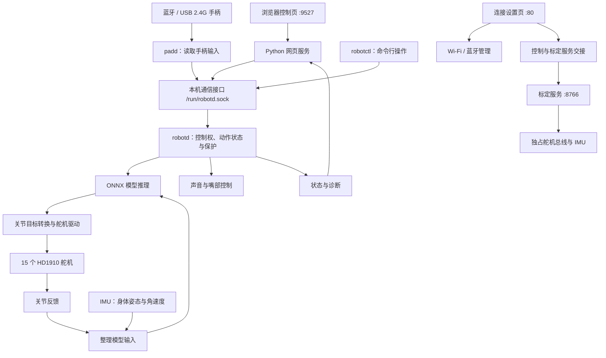

# EasyDuck

**面向泰山派 1M（RK3566）双足机器人的板端控制软件。**

[English](README.md) | **简体中文**

[中文文档](docs/zh-CN/README.md) · [English documentation](docs/en/README.md)

EasyDuck 基于 Microduck 的软件基础和 XGO Duck 的策略／动作流程，适配泰山派、15 个 HD1910 舵机和独立 I²C IMU。仓库提供从硬件设置、单机标定，到网页／手柄输入、策略闭环推理、舵机目标输出和运行诊断的板端软件。

行走动作由开发板运行 ONNX 策略产生：模型读取关节反馈、IMU、上一步动作和操作指令，主控再把输出转换为舵机目标。网页负责发指令和标定，不在浏览器里计算步态；3D 视图显示参考姿态和实测关节／躯干姿态，不是物理仿真器。

本仓库提供**应用源码、部署工具和五个 ONNX 模型**，不包含完整板级 SDK、Linux 发行版、可刷写固件发布包、机械设计或模型训练工程。下面的编译命令生成应用程序，不生成操作系统镜像。

> **许可范围：** 本仓库包含多种来源的代码和资源。记录的上游版本中，部分模型及衍生代码尚无明确再分发许可，不能将根目录 Apache-2.0 许可证套用于所有文件。分发前请阅读[许可证与来源](#许可证与来源)。

## 实物与效果展示

<table>
  <tr>
    <td colspan="2" align="center" valign="middle" width="33%" height="220">
      
    </td>
    <td colspan="2" align="center" valign="middle" width="33%" height="220">
      
    </td>
    <td colspan="2" align="center" valign="middle" width="33%" height="220">
      
    </td>
  </tr>
  <tr>
    <td colspan="2" align="center"><strong>坐下与起立</strong></td>
    <td colspan="2" align="center"><strong>头部控制</strong></td>
    <td colspan="2" align="center"><strong>捡东西</strong></td>
  </tr>
  <tr>
    <td colspan="3" align="center" valign="middle" width="50%" height="220">
      
    </td>
    <td colspan="3" align="center" valign="middle" width="50%" height="220">
      
    </td>
  </tr>
  <tr>
    <td colspan="3" align="center"><strong>行走</strong></td>
    <td colspan="3" align="center"><strong>站立与平衡</strong></td>
  </tr>
</table>


## 功能

- **运动控制：** 行走、零速站立、倒地恢复、指令坐下／起立和捡物。手柄或命令行保留翻滚请求入口，网页不提供翻滚和跳跃。
- **网页遥控器：** 移动与头部摇杆、独立颈部俯仰／歪头滑杆、速度调节、状态查看，以及与嘴部联动的按住鸣叫。
- **手柄控制：** 支持蓝牙连接的 PS5 DualSense，以及已验证、在 Linux 中识别为 Xbox 360 手柄的 USB/2.4G 接收器。使用现有的行走、头部、动作、嘴部和音效控制，通过控制权机制与网页交接。保留的躯干／踢腿按键不能视为当前 XGO 控制路径的可用能力。
- **标定工作台：** 分配舵机 ID，分别设置硬件中位和 HOME，设置方向与活动范围，查看 3D 反馈，记录整机站姿，导入导出 JSON。
- **两种 IMU：** BNO085、LSM6DSV16X。主控和标定台共用硬件配置，按型号分别保存安装方向和静止偏置。
- **连接设置：** 使用 NetworkManager 配置 Wi-Fi，通过 BlueZ 配对 PS5 手柄，并对已登记手柄尝试重连。
- **低电量保护：** 板级配置在有效平滑总线电压 ≤6.2V 后抢占普通控制，条件允许时坐下，随后断力并锁住普通控制，直到主控重启。不关闭 Linux，也不会让原本断力的机器人自动上力。
- **部署工具：** ARM64 编译、安装目录生成、文件哈希、保留已有配置、安装备份和文件回退。

动作能否执行取决于模型、配置、反馈和当前主控状态。编译成功或服务启动不代表已通过实物动作验收。

### 当前安装使用的控制流程与模型

安装清单中的 `40-xgoduck-reference.conf` 设置 `ROBOTD_CONTROL_PROFILE=xgoduck`，选择 `robotd/src/main.rs` 中的 50Hz 路径及 `xgo.rs` 动作状态机。源码还保留通用控制器，它的可选能力不能直接套到当前 XGO 路径上。

| 模型配置项 | 当前 XGO 路径中的用途 |
| --- | --- |
| `walk`、`stand` | 共用一个行走模型，零速时也用它站立 |
| `sitstand` | 倒地恢复的起身模型 |
| `posture` | 独立的指令坐下／起立模型，低电量坐下也使用它 |
| `ground_pick` | 通过动作相位编码驱动的捡物模型 |
| `roulade` | 翻滚模型，保留手柄／命令行请求，网页无按钮 |
| `kick_left`、`kick_right` | 未附带模型，参考配置均为 `none`，XGO 循环也不执行踢腿请求 |

策略输入为 61 维、输出为 14 个关节动作；驱动管理 15 个舵机，嘴部 ID34 单独控制。SCS 驱动用保存的编码器 HOME、方向和限位换算模型关节坐标，模型默认角度不是实物编码器标定。详见[模型接口与来源](docs/zh-CN/models.md)。

## 硬件与依赖

| 项目 | 支持配置 |
| --- | --- |
| 开发板 | 泰山派 1M，Rockchip RK3566，Linux ARM64、systemd |
| 舵机 | 15 个 HD1910，默认串口 `/dev/ttyS3` |
| 串口支持 | 与设备树匹配的 UART3 半双工方向控制；仅出现串口设备节点还不够 |
| IMU | **仅 BNO085、LSM6DSV16X 两种**，默认总线 `/dev/i2c-2` |
| 手柄 | PS5 DualSense 通过 BlueZ 接入；已验证的 USB/2.4G 接收器通过 Linux `xpad` 接入，见[驱动要求](docs/zh-CN/usb-gamepad.md) |
| 音频 | 已配置好的板端音频，以及 ALSA `aplay`、`amixer` |
| Python | 完整运行所有组件需要 Python 3.11+，包含标定台 |
| 原生库 | libudev，以及提供 `libonnxruntime.so` 的 ONNX Runtime 1.23+ |
| 连接设置 | NetworkManager／`nmcli`、BlueZ／`bluetoothctl`、系统 `libcrypt` |
| 浏览器 | JavaScript、支持 3D 工作台的 WebGL；three.js 已随仓库提供 |

GPIO 接线与有效电平以目标设备树为准。安装器不安装内核、板级驱动或 ONNX Runtime。各 IMU 支持的配置组合见 [IMU 驱动说明](docs/zh-CN/imu-drivers.md)。

目前不提供麦克风检测、ToF 深度检测或里程计。`robotctl` 的部分网络、配对和更新客户端依赖本仓库未提供的外部服务。

## 软件架构

EasyDuck 以 `robotd` 为控制核心：网页和手柄接收用户操作，主控结合舵机与姿态传感器的反馈运行模型，再把模型结果转换成舵机目标。连接设置、硬件标定和服务管理围绕这条控制链工作。

### 系统组成与职责



| 组成部分 | 负责什么 | 对应源码 |
| --- | --- | --- |
| 连接设置页 | 配置 Wi-Fi、配对蓝牙手柄、协调页面与控制服务切换 | `deploy/setup/` |
| 网页控制服务 | 接收网页摇杆和按钮操作，发送控制请求，返回机器人状态 | `web/` |
| `padd` | 读取手柄输入，将按键和摇杆转换成统一控制请求 | `runtime/padd/` |
| `robotctl` | 命令行控制、状态查看和诊断 | `runtime/robotctl/` |
| `robotd` | 管理控制权和动作状态，运行模型，协调硬件读写与保护逻辑 | `runtime/robotd/` |
| 硬件与推理模块 | 实现舵机通信、IMU 数据处理、模型输入输出和推理 | `runtime/duck-control/` |
| 标定服务 | 分配舵机 ID，设置中位、HOME、方向、范围及 IMU 标定 | `calibration/` |
| 声音程序与播放逻辑 | `sounds` 生成音效库，主控侧逻辑负责运行时播放与嘴部配合 | `runtime/sounds/`、`runtime/robotd/` |

`duck-ipc-proto` 定义程序之间的消息格式，`robotd-params` 解析配置，`kinematics` 提供姿态几何计算。这些共用模块编入程序，不需要分别启动服务。详见 [Rust 工作区说明](docs/zh-CN/runtime.md)。

### 从用户操作到机器人动作

以推动手柄向前为例，`padd` 先把摇杆转换成“向前移动”的命令，通过本机 Unix socket 发给 `robotd`。网页操作也进入同一套主控接口。主控判断当前控制权、动作状态和保护条件后，再决定如何执行。

当前 XGO 控制路径按 **50 Hz，约每 20 毫秒一轮**的节奏更新。每轮结合关节反馈、IMU 和有效命令，构造模型输入、执行推理，再把输出转换成舵机目标。执行后的反馈进入后续循环，让机器人持续调整动作。Linux 调度和硬件通信会影响实际耗时，这不是严格的实时期限保证。

| 模型输入 | 数量 | 作用 |
| --- | ---: | --- |
| 身体角速度 | 3 | 判断身体正在怎样转动 |
| 身体坐标中的重力方向 | 3 | 判断身体向哪边倾斜 |
| 关节位置 | 14 | 表示相对模型参考姿态的关节位置 |
| 关节速度 | 14 | 表示关节的运动情况 |
| 上一次模型输出 | 14 | 为当前计算提供上一轮动作信息 |
| 移动、头部和身体命令 | 13 | 表达用户操作；当前控制路径未启用的项保持为零 |

合计 **61 个输入值、14 个动作输出值**。舵机驱动根据本机标定，将模型关节目标转换成实际舵机目标；嘴部 ID34 由独立逻辑控制。输入顺序、单位、关节方向和动作缩放必须与模型一致，不能随意替换。接口与来源见[模型说明](docs/zh-CN/models.md)。

### 网页、手柄与硬件访问

正式运行时，`robotd` 统一读写舵机总线与 IMU。网页、`padd` 和 `robotctl` 通过本机通信接口提交请求，其中网页与手柄的控制权由主控统一管理。

自动选择时，在线手柄优先；用户主动选择网页控制后，网页保持控制权。交还手柄需要松开摇杆、扳机和按键，切换后还需通过回中检查。**获得控制权与开启行走是两个独立步骤**，切换入口本身不会请求行走。

手柄支持分为系统驱动和应用读取两层：BlueZ 与相关输入驱动支持蓝牙手柄，`xpad` 支持已验证的 USB 接收器；它们将手柄呈现为 Linux 输入设备，再由 `padd` 读取并转换。网页和手柄最终共用同一条主控执行链。

### 标定与配置如何进入正式控制

标定服务需要直接读写舵机和 IMU，因此与正式控制分开运行。登录后的页面导航协调服务交接，systemd 服务配置声明互斥，避免标定服务与 `robotd` 同时占用硬件。

典型流程为：**扶稳机器人 → 停止正式控制并请求断力 → 标定服务接管 → 保存本机参数 → 退出标定 → 正式服务重新读取配置**。通信或供电故障时，服务切换成功不能证明每个舵机都已断力。

`robotd.toml` 保存硬件与模型等运行配置，`visual_calibration.json` 保存本机舵机和 IMU 标定。标定把实际安装位置、方向和范围转换成软件使用的统一坐标。网页草稿保存前不会持久生效，保存后也不会实时重配已运行的主控；退出标定时重启正式服务，才能重新打开硬件并读取保存结果。配置文件优先级见[配置说明](docs/zh-CN/configuration.md)。

### 开机启动与运行保护

Linux 的 `systemd` 负责管理服务，按各自配置启动程序、在异常退出后重启，并保留日志。它负责进程运行；`robotd` 内部负责控制状态、输入超时、反馈与传感器检查、低电量处理等运行逻辑。进程重启不能覆盖所有卡住或硬件故障。

**程序已启动、控制已准备好、机器人已开始动作是不同状态。** 模板默认关闭动作策略，自启动不等于自动上力或行走。低电量坐下也依赖当时的硬件和动作状态，无法执行时仍需按保护逻辑处理，不能把保护请求视为动作必然完成。

### 系统与扩展边界

板级 Linux、UART 半双工支持、USB 输入驱动和相关系统组件由 SDK／系统镜像提供；本仓库负责应用程序、模型、配置及应用部署。安装应用不能代替安装匹配内核的驱动。

扩展控制入口时，可以复用主控接口；更换 IMU 时，需要适配驱动并统一数据单位、坐标方向、安装标定和数据时效；更换模型时，需要遵守现有输入输出约定。模型训练与板端推理分开维护，本仓库不包含完整训练环境。

连接设置页需要登录，但控制页（`:9527`）和标定台（`:8766`）的接口本身不校验账号登录，默认监听全部网卡。网页来源检查、控制权切换都不等于账号认证。请只在可信网络内使用，不要把这两个端口开放到互联网。

## 从源码编译

在 **Linux x86-64 编译机**准备 Bash、Docker Engine、GNU tar、`sha256sum` 和 `file`，进入克隆后的仓库根目录执行：

```sh
docker build -f deploy/Dockerfile -t easyduck-build:1.98.1 .
docker run -d --name easyduck-build --network none easyduck-build:1.98.1
bash deploy/build.sh
(cd models && sha256sum -c SHA256SUMS)
```

创建编译环境需要联网。之后应用通过 Cargo 锁文件和缓存依赖离线编译。Dockerfile 指定 Rust 1.98.1，目标为 `aarch64-unknown-linux-gnu`；工作区声明的最低 Rust 版本为 1.89。这套流程不是 Windows 原生编译。

已有同名容器但已停止时，用 `docker start easyduck-build`，不用重复创建。依赖变化后可能需要重建编译环境。容器和工具链覆盖参数见[编译与部署](docs/zh-CN/deployment.md)。

| 产物 | 内容 |
| --- | --- |
| `build/bin/` | 四个 ARM64 可执行程序 |
| `build/logs/arm-build.log` | 应用编译日志 |
| `build/binaries-SHA256SUMS` | 程序哈希清单 |
| `build/binary-types.txt` | 二进制架构信息 |

模型哈希检查只证明文件完整，不证明动作效果。完整固件需要另由目标 SDK 处理内核、设备树、rootfs、服务启用和打包。

## 安装与配置

### 在编译机检查安装目录

编译完成后执行：

```sh
python3 deploy/install.py --root build/stage --profile examples
```

这会把程序、模型、网页、配置模板、服务定义和许可文件复制到专用安装目录，不访问硬件、不启动服务。目录中已有文件可能被更新。

`examples` 提供格式样例，`board` 提供泰山派硬件参考参数。**两者都是待标定模板，策略默认关闭。** 只有 `board` 显式启用低电量坐下保护。

这里的 `[policy] enabled = false` 会阻止控制器加载动作模型，不只是“初始不上力”。完成本机标定并确认模型路径与依赖后，需要在板端 `/etc/robot/robotd.toml` 将 `[policy] enabled` 改为 `true`，下次启动主控才加载策略。重启或交接服务前先扶稳机器人；加载策略本身仍不等于请求行走或上力。

### 安装到机器人

先准备板端依赖，把安装源和 ARM64 程序传到板端。扶稳机器人，停止冲突的控制或标定服务，再在**开发板上的安装源目录**执行：

```sh
sudo python3 deploy/install.py --root / --profile board --install-on-board
```

安装器输出包含 `manifest.json` 的备份目录。已有 `/etc/robot/` 文件默认保留。`--replace-config` 会替换配置并备份，不要在已标定机器上随意使用。

安装连接设置网页及重连定时器时，选择一个**已有系统账号**，将 `your-user` 替换为该账号：

```sh
sudo bash deploy/setup/install.sh --port 80 --user your-user
```

此命令会启动设置服务，使用现有账号的系统密码，并保留已有 `/etc/easyduck/setup.env`。它不创建账号、不设置密码、不配置 SSH，也不创建 USB 网络。详见[连接设置](docs/zh-CN/connection-setup.md)。

在准备好的板端先预览，再执行正式控制服务启动：

```sh
bash deploy/start.sh --preview
sudo bash deploy/start.sh --execute
```

这里启动的是正式控制服务，不是标定服务；也不能替代前面的设置页安装，或据此认定开机启用关系已经完成。依赖安装、核对与回退见[部署说明](docs/zh-CN/deployment.md)和[完整软件使用说明](docs/zh-CN/software-guide.md)。

### 运行文件

| 板端路径 | 用途 |
| --- | --- |
| `/etc/robot/robotd.toml` | 硬件、模型路径、安全与音频配置 |
| `/etc/robot/visual_calibration.json` | 舵机和按型号隔离的 IMU 标定 |
| `/etc/robot/zero_pos.json` | 标定基线与旧格式回退输入 |
| `/etc/robot/scs_joint_gains.json` | 关节增益 |
| `/etc/easyduck/setup.env` | 设置页账号和端口 |
| `/opt/robot/daemon/policies/` | 已安装模型 |

不要把单机标定、凭据、Wi-Fi 配置、蓝牙配对和浏览器会话写入通用安装模板。文件读取优先级见[配置说明](docs/zh-CN/configuration.md)。

## 标定

进入标定前先扶稳机器人：服务交接会停止正式控制并请求解除力矩。舵机供电或通信异常时，页面切换成功不代表所有舵机都已断力。不要用手硬掰已上力的关节。

新机器人先分配不重复的舵机 ID；已经分配好的不用重做。逐关节设置初始硬件中位与 HOME、记录安全上下限、对照模型正方向执行一次实物步进，再保存。设中位与记录 HOME 是两个独立操作，以后只调 HOME 不必清除原有中位、方向或范围。

所有关节保存后，回 HOME 检查实物躯干，再记录整机参考站姿。模板中的 `2048` 和 `0～4095` 都只是占位值，不是实测标定。

**「检查 IMU」仅识别 BNO085 和 LSM6DSV16X。** 采集站直，以及前倾／左倾中的至少一种；页面也提供后倾、右倾。每种姿态保持静止至少 2 秒，计算安装方向，对照实物检查模型倾斜，再采集静止偏置并保存。

两部分都完成后导出 JSON 备份。导入数据先进入草稿，核对后保存全部草稿才会持久保存。备份只用于对应机器。工作台及完全不接硬件的 `--mock` 预览见[标定台说明](docs/zh-CN/calibration.md)。当前网页界面使用中文。

## 网页与手柄操作

安装后使用开发板当前可达的地址，应用脚本不会创建固定 IP。

| 页面 | 默认地址 |
| --- | --- |
| 连接设置 | `http://BOARD_IP/` |
| 网页控制 | `http://BOARD_IP:9527/` |
| 标定台 | 服务交接后访问 `http://BOARD_IP:8766/` |

### 网页控制

点击「用网页控制」；如果页面已经由当前浏览器接管，不用重复点击。先用「默认站姿」检查站姿，再点「开启行走」。

| 操作 | 功能 |
| --- | --- |
| 左摇杆 | 前进、后退、左转、右转 |
| 右摇杆 | 头部俯仰、左右看 |
| 两条滑杆 | 颈部俯仰、歪头；「头部回中」恢复头部指令 |
| 按住鸣叫 | 叫声和张嘴幅度快速增加，松手停声并合嘴 |
| 坐下／起立、捡物 | 按可用模型显示，在允许的动作状态下启用 |
| 键盘 | `W/S` 前后、`A/D` 转向，空格断力 |

速度默认 50%。松开移动摇杆或离开窗口会归零移动输入，不会解除支撑力矩。「断力」会解除力矩，先托住机身再用。

### USB / 2.4G 接收器手柄

将接收器插入开发板的 USB 主机口，再打开手柄并切换到 2.4G 模式，按手柄厂商的说明与接收器配对。这种连接方式不使用设置页的蓝牙扫描。

目前验证过的接收器 USB ID 为 `045e:028e`，在 Linux 中显示为 **Microsoft X-Box 360 pad**，连接、按键对应和机器人控制均已实测。这不代表所有品牌、所有型号的 2.4G 手柄都已兼容。

系统镜像需要包含 `xpad` 驱动和开机加载规则，单独安装应用文件不会安装内核驱动。SDK 镜像构建已加入这些配置，并在最终镜像解包后检查是否完整，详见 [USB / 2.4G 手柄支持](docs/zh-CN/usb-gamepad.md)。

如果当前由网页控制，先点「交还手柄」，松开摇杆、扳机和按键，等待页面显示控制权归手柄。切换控制权本身不会开启行走，需要再按 **Start**，它对应下表中的 **Options**。**A** 对应捡物。

| Xbox 风格按键 | 对应下方 PS5 表中的按键 |
| --- | --- |
| Start | Options |
| A / B / X / Y | × / ○ / □ / △ |
| LB / RB | L1 / R1 |
| LT / RT | L2 / R2 |
| Back 或 Select | Create |
| Guide | PS |

手柄未连接时，接收器可能显示为 **Receiver Update**，连接后才切换为 Xbox 设备。Back/Select 不是普通停止键，长按约 2 秒会请求系统关机。

### PS5 DualSense

首次按住 **PS + Create**，等灯条闪烁，再到设置页扫描配对。已配对手柄按 PS 唤醒。如果之前指定了网页控制，点「交还手柄」，松开所有摇杆和扳机，等待归零交接。

| 操作 | 功能 |
| --- | --- |
| Options | 开启行走；再按一次回默认站姿 |
| 左摇杆 | 前后和左右横移 |
| 右摇杆左右 | 转向 |
| 方向键 ↓／× | 坐下起立／捡物，取决于模型与当前状态 |
| △ | 切换头部模式：左摇杆头部俯仰／左右看，右摇杆颈部俯仰／歪头 |
| ○ | 保留躯干模式输入映射，但当前 XGO 路径会将身体指令归零 |
| R2／L2 | 张嘴并短叫／持续鸣叫 |
| □ | 翻滚请求，取决于模型和动作状态 |
| L1／R1 | 保留踢腿请求，当前安装的 XGO 路径不执行 |
| PS | 受管控制模式下断力 |
| Create 长按约 2 秒 | 提交系统关机请求；不能据此认定当前 XGO 路径的关机前坐下已验证可用 |

手柄与网页的分工不同：手柄左摇杆左右是横移，转向在右摇杆。同一时间只有一端控制，Create 不是普通停止键。

低电量处理与手动关机是两个流程，低电量保护**不关闭 Linux**。处理时序与异常回退见[低电量自动坐下](docs/zh-CN/low-battery.md)。

## 诊断与测试

板端只读查看：

```sh
systemctl status robotd padd xgoduck-web
journalctl -u robotd -f
/opt/robot/daemon/current/bin/robotctl monitor
```

按钮变灰时，先检查连接是否新鲜、IMU 是否就绪、当前控制权、输入归零交接及页面提示，再请求动作。

Linux 编译机上的 Rust 测试不传入机器人设备：

```sh
docker run --rm --network none \
  --mount type=bind,src="$(pwd)/runtime",dst=/work/runtime,readonly \
  -e CARGO_TARGET_DIR=/tmp/easyduck-tests -w /work/runtime \
  easyduck-build:1.98.1 cargo test --locked --offline --workspace
```

安装 Python、Node.js 后，在仓库根目录执行网页测试：

```sh
python3 -m unittest discover -s web/tests -v
node web/tests/controls.test.cjs
```

这些检查不能证明实物运动已验收。其他测试和模拟预览见各组件详细文档。

不接机器人即可检查双语文档、示例与本地链接：

```sh
python3 tools/check_docs.py
```

### 保留的基础模块与能力边界

- `robotctl configure` 根据主控参数定义编辑本地 TOML；`monitor` 读取机器人遥测，也可订阅 `padd` 的只读原始输入流。
- `robotctl net/system/update` 以及部分配对／状态命令调用 `configd`、`updaterd` 等外部服务。协议和客户端不代表这些服务已经包含在仓库里；现有设置网页则直接调用 NetworkManager、BlueZ。
- 运动学模块解析内嵌 MJCF，计算正运动学和头部朝向，不是完整 MuJoCo 仿真或训练环境。旧 `robot.look` 意图入口也不能直接等同于 XGO 的头部指令链路。
- 音频部分包含种子合成、WAV 音效库、实时鸣叫及合唱合成／状态代码，但没有完整提供多机发现与传输服务，不能据此承诺开箱即用的多机合唱。
- `robotd --fake` 和标定台 `--mock` 用于无硬件开发，不模拟真实接触动力学。可选 `ROBOTD_IO_TRACE` 记录反馈、推理和总线事件，也不等于提供了模型训练流水线。

## 项目目录

| 路径 | 内容 |
| --- | --- |
| [runtime/](docs/zh-CN/runtime.md) | Rust 主控、手柄、命令行、音效程序及共用模块 |
| [web/](docs/zh-CN/web-control.md) | 浏览器遥控器与 Python 网关 |
| [calibration/](docs/zh-CN/calibration.md) | 舵机／IMU 标定台、网格和浏览器依赖 |
| [config/](docs/zh-CN/configuration.md) | 待标定模板和板级参数 |
| [models/](docs/zh-CN/models.md) | 五个模型、接口、来源清单与哈希 |
| [deploy/](docs/zh-CN/deployment.md) | 编译、安装、核对、回退、systemd 和内核补丁 |
| [deploy/setup/](docs/zh-CN/connection-setup.md) | Wi-Fi、PS5 配对重连与页面导航 |
| [docs/](docs/zh-CN/README.md) | 成对维护的中文、英文详细文档 |
| [examples/imu/](examples/imu/README.zh-CN.md) | 开发者使用的未完成驱动模板 |
| [assets/images/](assets/images/) | 两个 README 共用的实物照片 |
| [assets/demos/](assets/demos/) | 两个 README 共用的展示动图 |
| [tools/check_docs.py](tools/check_docs.py) | 文档一致性与本地链接检查 |
| [完整使用说明](docs/zh-CN/software-guide.md) | 安装和操作细节 |
| [IMU 驱动](docs/zh-CN/imu-drivers.md) | 配置与共用 IMU 接口 |
| [robotctl](docs/zh-CN/robotctl.md) | 命令行参考 |
| [音效工具](docs/zh-CN/sounds.md) | 音效库生成 |

## 参与开发

遵守[仓库维护规则](AGENTS.md)和[双语文档规则](docs/AGENTS.md)。

描述具体问题、预期行为、对应组件、硬件／模型配置和检查结果。模拟结果与实物观察分开说明，贡献中不要混入私有标定、凭据、日志、构建产物和固件文件。

保留原有署名，新增资源补充来源和许可记录。修改观测顺序、关节方向或动作缩放时，保持模型与主控接口一致。提出改动前完成相应编译测试；实物验证需有明确操作安排并扶稳机器人。

## 许可证与来源

根目录项目许可证为 [Apache-2.0](LICENSE)。第三方组件保留各自许可：标定 IMU Python 代码使用 GPL-3.0-or-later，Linux 内核补丁使用 GPL-2.0-only，three.js 使用 MIT。

Rust 主体来源于 Pollen Robotics 的 Microduck。部分动作流程、网页代码和预训练模型来源于记录的 XGO Duck 版本。四个上游模型及部分衍生内容的再分发许可尚未明确，自训姿态模型另有来源记录。署名不能替代再分发授权。

逐项范围见 [NOTICE](NOTICE)、[第三方声明](THIRD_PARTY_NOTICES.md)、[模型来源清单](models/manifest.json)和[许可正文](LICENSES)，不能将所有模型或素材统一视为 Apache-2.0。
