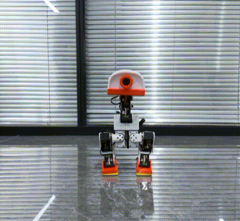
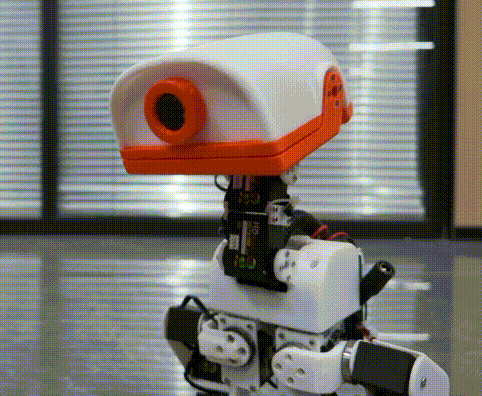
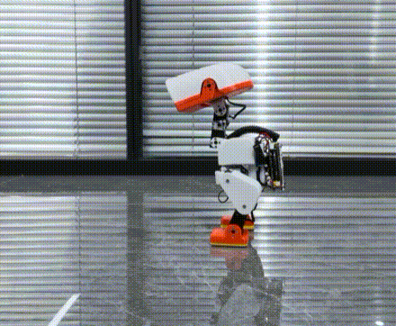
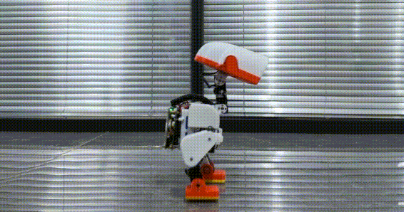
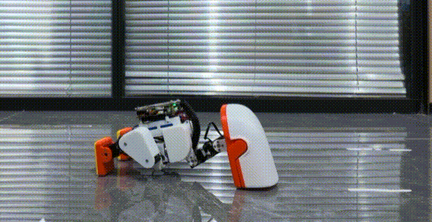
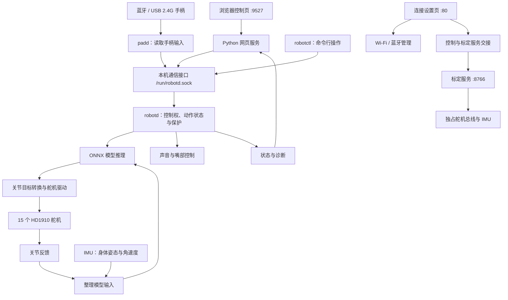

# EasyDuck

**基于泰山派 1M 的开源双足机器人，让动作模型在开发板上驱动一只会走路的鸭子。**

[English](README.md) | **简体中文** · [硬件与制作教程](https://oshwlab.com/lckfb-team/project_eouzeufa) · [软件文档](docs/zh-CN/README.md) · [模型训练](https://github.com/LuwuDynamics/xgoduck_rl)

EasyDuck 使用泰山派 1M（RK3566）、15 个 HD1910 舵机和姿态传感器，实现网页／手柄遥控、行走、站立、坐下起立、倒地恢复、捡物和头部控制。

动作策略在开发板本地运行。主控把用户指令、机身姿态、关节反馈和上一轮动作送入 ONNX 模型，再将模型输出转换为舵机目标，持续根据新反馈调整动作。

## 效果展示

<table>
  <tr>
    <td colspan="2" align="center" valign="middle" width="33%" height="220">
      
    </td>
    <td colspan="2" align="center" valign="middle" width="33%" height="220">
      
    </td>
    <td colspan="2" align="center" valign="middle" width="33%" height="220">
      
    </td>
  </tr>
  <tr>
    <td colspan="2" align="center"><strong>坐下与起立</strong></td>
    <td colspan="2" align="center"><strong>头部控制</strong></td>
    <td colspan="2" align="center"><strong>捡东西</strong></td>
  </tr>
  <tr>
    <td colspan="3" align="center" valign="middle" width="50%" height="220">
      
    </td>
    <td colspan="3" align="center" valign="middle" width="50%" height="220">
      
    </td>
  </tr>
  <tr>
    <td colspan="3" align="center"><strong>行走</strong></td>
    <td colspan="3" align="center"><strong>站立与平衡</strong></td>
  </tr>
</table>

## 开源项目与资料

硬件、软件和教程文档已开源。各部分的入口和用途如下。

| 入口 | 内容 |
| --- | --- |
| [硬件开源](https://oshwlab.com/lckfb-team/project_eouzeufa) | 硬件设计资料 |
| [软件源码](https://github.com/jlckfb/easyduck) | 本仓库，包含板端控制程序、网页、标定工具、部署脚本及动作模型 |
| [制作教程](https://oshwlab.com/lckfb-team/project_eouzeufa) | 硬件与教程共用同一个项目页面，按教程完成制作与使用 |
| [XGO Duck 训练仓库](https://github.com/LuwuDynamics/xgoduck_rl) | 上游仿真与强化学习工程，提供训练环境、策略回放和 ONNX 导出 |
| [软件使用说明](docs/zh-CN/software-guide.md) | EasyDuck 的软件安装、标定、日常操作与回退 |

训练在 GPU 电脑上进行，导出的 ONNX 模型交给泰山派上的 EasyDuck 运行。XGO Duck 训练工程基于 [Pollen Robotics/microduck_rl](https://github.com/pollen-robotics/microduck_rl)。本项目各模型的来源、固定版本和接口记录在[模型说明](docs/zh-CN/models.md)与[模型清单](models/manifest.json)中。

## 主要功能

| 功能 | 说明 |
| --- | --- |
| 动作控制 | 行走、零速站立、倒地恢复、指令坐下／起立、捡物，按所加载模型和当前状态执行 |
| 网页遥控 | 双摇杆、头部控制、速度调节、鸣叫和状态查看；遥控页支持中英切换 |
| 手柄遥控 | PS5 DualSense 蓝牙连接，以及已验证的 Xbox 360 协议 USB／2.4G 接收器；可与网页交接控制权 |
| 标定工作台 | 分配舵机 ID，设置硬件中位、HOME、方向和范围，查看 3D 反馈，导入导出本机标定 |
| 姿态传感器 | 支持 BNO085、LSM6DSV16X，按型号保存安装方向与静止偏置 |
| 连接与运行管理 | Wi-Fi 设置、PS5 配对重连、服务自启动和异常退出重启 |
| 低电量保护 | 板级配置在有效平滑总线电压 ≤6.2V 时抢占普通控制，条件允许时坐下，随后断力并锁定普通控制 |

动作可用性取决于模型、标定、供电和反馈状态。低电量保护不关闭 Linux。网页不提供跳跃或翻滚按钮，保留的踢腿／躯干输入也不代表当前控制流程已执行这些动作。

## 开始使用

### 硬件准备

| 部件 | 当前支持 |
| --- | --- |
| 主控 | 泰山派 1M，RK3566，Linux ARM64、systemd |
| 舵机 | 15 个 HD1910，默认使用 UART3，需要匹配的半双工方向控制 |
| 姿态传感器 | BNO085 或 LSM6DSV16X，默认 I²C 总线为 `/dev/i2c-2` |
| 控制端 | 浏览器，或 PS5 DualSense／已验证的 USB／2.4G 接收器手柄 |

系统需具备 Python 3.11+、ONNX Runtime、ALSA、NetworkManager、BlueZ 及匹配的板级驱动。USB 接收器需要内核中的 `xpad` 支持。依赖与安装细节见[部署说明](docs/zh-CN/deployment.md)和[手柄驱动说明](docs/zh-CN/usb-gamepad.md)。

### 第一次让鸭子动起来

1. 按[制作教程](https://oshwlab.com/lckfb-team/project_eouzeufa)准备硬件和系统，完成接线。
2. 打开开发板地址的连接设置页，配置 Wi-Fi 或配对手柄。地址获取见[网络访问说明](docs/zh-CN/network-access.md)。
3. 扶稳机器人，进入标定台，完成舵机 ID、硬件中位、HOME、方向、活动范围和 IMU 标定，导出备份。
4. 按[配置说明](docs/zh-CN/configuration.md)核对模型和本机参数。仓库配置模板的策略默认关闭，完成标定后再启用模型加载。
5. 进入遥控页，点击「用网页控制」，先检查「默认站姿」，再开启行走。使用手柄时，交还控制权、松开摇杆与按键，然后按 Start／Options。

| 页面 | 默认地址 |
| --- | --- |
| 连接设置 | `http://BOARD_IP/` |
| 网页遥控 | `http://BOARD_IP:9527/` |
| 标定工作台 | 经页面交接服务后访问 `http://BOARD_IP:8766/` |

`BOARD_IP` 为开发板当前地址。「断力」会解除支撑力矩，操作前先托稳机身。完整按键表、标定步骤和配置说明见[软件使用说明](docs/zh-CN/software-guide.md)。

### 从源码构建应用

在 Linux x86-64 编译机准备 Docker Engine、Bash、GNU tar、`sha256sum` 和 `file`，进入本仓库根目录执行：

```sh
docker build -f deploy/Dockerfile -t easyduck-build:1.98.1 .
docker run -d --name easyduck-build --network none easyduck-build:1.98.1
bash deploy/build.sh
(cd models && sha256sum -c SHA256SUMS)
```

首次创建编译环境需要联网。ARM64 程序位于 `build/bin/`。已有同名容器时按[编译与部署](docs/zh-CN/deployment.md)处理。完整系统镜像由板级 SDK 构建，本仓库安装器负责应用文件与服务集成。

## 软件架构

EasyDuck 以 `robotd` 为控制核心：网页和手柄接收用户操作，主控结合舵机与姿态传感器的反馈运行模型，再把模型结果转换成舵机目标。连接设置、硬件标定和服务管理围绕这条控制链工作。

### 系统组成与职责



| 组成部分 | 负责什么 | 对应源码 |
| --- | --- | --- |
| 连接设置页 | 配置 Wi-Fi、配对蓝牙手柄、协调页面与控制服务切换 | `deploy/setup/` |
| 网页控制服务 | 接收网页摇杆和按钮操作，发送控制请求，返回机器人状态 | `web/` |
| `padd` | 读取手柄输入，将按键和摇杆转换成统一控制请求 | `runtime/padd/` |
| `robotctl` | 命令行控制、状态查看和诊断 | `runtime/robotctl/` |
| `robotd` | 管理控制权和动作状态，运行模型，协调硬件读写与保护逻辑 | `runtime/robotd/` |
| 硬件与推理模块 | 实现舵机通信、IMU 数据处理、模型输入输出和推理 | `runtime/duck-control/` |
| 标定服务 | 分配舵机 ID，设置中位、HOME、方向、范围及 IMU 标定 | `calibration/` |
| 声音程序与播放逻辑 | `sounds` 生成音效库，主控侧逻辑负责运行时播放与嘴部配合 | `runtime/sounds/`、`runtime/robotd/` |

`duck-ipc-proto` 定义程序之间的消息格式，`robotd-params` 解析配置，`kinematics` 提供姿态几何计算。这些共用模块编入程序，不需要分别启动服务。详见 [Rust 工作区说明](docs/zh-CN/runtime.md)。

### 从用户操作到机器人动作

以推动手柄向前为例，`padd` 先把摇杆转换成“向前移动”的命令，通过本机 Unix socket 发给 `robotd`。网页操作也进入同一套主控接口。主控判断当前控制权、动作状态和保护条件后，再决定如何执行。

当前 XGO 控制路径按 **50 Hz，约每 20 毫秒一轮**的节奏更新。每轮结合关节反馈、IMU 和有效命令，构造模型输入、执行推理，再把输出转换成舵机目标。执行后的反馈进入后续循环，让机器人持续调整动作。Linux 调度和硬件通信会影响实际耗时，这不是严格的实时期限保证。

| 模型输入 | 数量 | 作用 |
| --- | ---: | --- |
| 身体角速度 | 3 | 判断身体正在怎样转动 |
| 身体坐标中的重力方向 | 3 | 判断身体向哪边倾斜 |
| 关节位置 | 14 | 表示相对模型参考姿态的关节位置 |
| 关节速度 | 14 | 表示关节的运动情况 |
| 上一次模型输出 | 14 | 为当前计算提供上一轮动作信息 |
| 移动、头部和身体命令 | 13 | 表达用户操作；当前控制路径未启用的项保持为零 |

合计 **61 个输入值、14 个动作输出值**。舵机驱动根据本机标定，将模型关节目标转换成实际舵机目标；嘴部 ID34 由独立逻辑控制。输入顺序、单位、关节方向和动作缩放必须与模型一致，不能随意替换。接口与来源见[模型说明](docs/zh-CN/models.md)。

### 网页、手柄与硬件访问

正式运行时，`robotd` 统一读写舵机总线与 IMU。网页、`padd` 和 `robotctl` 通过本机通信接口提交请求，其中网页与手柄的控制权由主控统一管理。

自动选择时，在线手柄优先；用户主动选择网页控制后，网页保持控制权。交还手柄需要松开摇杆、扳机和按键，切换后还需通过回中检查。**获得控制权与开启行走是两个独立步骤**，切换入口本身不会请求行走。

手柄支持分为系统驱动和应用读取两层：BlueZ 与相关输入驱动支持蓝牙手柄，`xpad` 支持已验证的 USB 接收器；它们将手柄呈现为 Linux 输入设备，再由 `padd` 读取并转换。网页和手柄最终共用同一条主控执行链。

### 标定与配置如何进入正式控制

标定服务需要直接读写舵机和 IMU，因此与正式控制分开运行。登录后的页面导航协调服务交接，systemd 服务配置声明互斥，避免标定服务与 `robotd` 同时占用硬件。

典型流程为：**扶稳机器人 → 停止正式控制并请求断力 → 标定服务接管 → 保存本机参数 → 退出标定 → 正式服务重新读取配置**。通信或供电故障时，服务切换成功不能证明每个舵机都已断力。

`robotd.toml` 保存硬件与模型等运行配置，`visual_calibration.json` 保存本机舵机和 IMU 标定。标定把实际安装位置、方向和范围转换成软件使用的统一坐标。网页草稿保存前不会持久生效，保存后也不会实时重配已运行的主控；退出标定时重启正式服务，才能重新打开硬件并读取保存结果。配置文件优先级见[配置说明](docs/zh-CN/configuration.md)。

### 开机启动与运行保护

Linux 的 `systemd` 负责管理服务，按各自配置启动程序、在异常退出后重启，并保留日志。它负责进程运行；`robotd` 内部负责控制状态、输入超时、反馈与传感器检查、低电量处理等运行逻辑。进程重启不能覆盖所有卡住或硬件故障。

**程序已启动、控制已准备好、机器人已开始动作是不同状态。** 模板默认关闭动作策略，自启动不等于自动上力或行走。低电量坐下也依赖当时的硬件和动作状态，无法执行时仍需按保护逻辑处理，不能把保护请求视为动作必然完成。

### 系统与扩展边界

板级 Linux、UART 半双工支持、USB 输入驱动和相关系统组件由 SDK／系统镜像提供；本仓库负责应用程序、模型、配置及应用部署。安装应用不能代替安装匹配内核的驱动。

扩展控制入口时，可以复用主控接口；更换 IMU 时，需要适配驱动并统一数据单位、坐标方向、安装标定和数据时效；更换模型时，需要遵守现有输入输出约定。模型训练与板端推理分开维护，本仓库不包含完整训练环境。

连接设置页需要登录，但控制页（`:9527`）和标定台（`:8766`）的接口本身不校验账号登录，默认监听全部网卡。网页来源检查、控制权切换都不等于账号认证。请只在可信网络内使用，不要把这两个端口开放到互联网。


## 文档导航

| 你想做什么 | 阅读 |
| --- | --- |
| 安装、配置和日常使用 | [软件使用说明](docs/zh-CN/software-guide.md) |
| 编译、安装应用或回退 | [编译与部署](docs/zh-CN/deployment.md) |
| 配置网络、配对与重连手柄 | [连接设置](docs/zh-CN/connection-setup.md) · [USB／2.4G 手柄](docs/zh-CN/usb-gamepad.md) |
| 调整舵机和姿态传感器 | [标定台](docs/zh-CN/calibration.md) · [IMU 接入](docs/zh-CN/imu-drivers.md) |
| 理解模型、接口和来源 | [动作模型](docs/zh-CN/models.md) |
| 了解低电量处理 | [低电量保护](docs/zh-CN/low-battery.md) |
| 查阅全部文档与模块介绍 | [中文文档目录](docs/zh-CN/README.md) |

## 代码目录

| 目录 | 职责 |
| --- | --- |
| [runtime/](runtime/README.zh-CN.md) | Rust 主控、手柄、命令行、音效程序和共用库 |
| [web/](web/README.zh-CN.md) | 浏览器遥控器和 Python 网关 |
| [calibration/](calibration/README.zh-CN.md) | 舵机、IMU 标定和 3D 工作台 |
| [config/](config/README.zh-CN.md) | 公开配置模板与板级参数 |
| [models/](models/README.zh-CN.md) | ONNX 模型、来源与哈希 |
| [deploy/](deploy/README.zh-CN.md) | 编译、安装、回退、服务和驱动集成 |
| [docs/](docs/README.zh-CN.md) | 成对维护的中英文使用文档 |
| [assets/](assets/README.zh-CN.md) | 实物照片与展示动图 |
| [examples/](examples/README.zh-CN.md) · [tools/](tools/README.zh-CN.md) | 开发示例与仓库检查工具 |

## 参与开发

欢迎提交问题和改进。报告问题时说明硬件、模型配置、复现步骤和日志，提交代码前完成对应检查。实物运动测试需安排好承托和断电条件。

开发约定见[仓库维护规则](AGENTS.md)，文档修改需同步中英文。新增代码和素材请记录来源与许可，私有标定、凭据和构建产物应留在仓库外。

## 致谢与许可证

EasyDuck 的 Rust 软件基础来自 Pollen Robotics 的 Microduck，部分动作流程、网页和模型来自 XGO Duck，训练参考 XGO Duck RL 与 Microduck RL。感谢上游项目及贡献者。

项目根许可证为 [Apache-2.0](LICENSE)。第三方内容保留各自许可，包含 GPL-3.0-or-later、GPL-2.0-only 和 MIT。记录的上游版本中，四个动作模型和部分衍生内容的再分发条款尚未明确，需按具体文件核对。

来源、适配记录与许可范围见 [NOTICE](NOTICE)、[第三方声明](THIRD_PARTY_NOTICES.md)、[模型清单](models/manifest.json)和[许可正文](LICENSES/README.zh-CN.md)。
